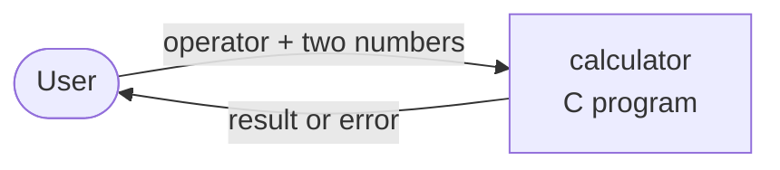

# Basic Calculator in C: High-Level Design

A command-line calculator for the four basic operations, written as a first C program. For code-level detail see the [Low-Level Design](lld.md).

## 1. Context

## 2. Scope

| In scope | Out of scope |
|---|---|
| `+`, `-`, `*`, `/` on two decimal numbers | Expressions with more than two numbers |
| Division-by-zero and unknown-operator errors | Repeating calculations in a loop |
| Two decimal places in output | Input validation for non-numeric text |

## 3. Tech

| Item | Choice |
|---|---|
| Language | C (standard library `stdio.h` only) |
| Build | Any C compiler, e.g. `gcc calculator.c -o calculator` |
