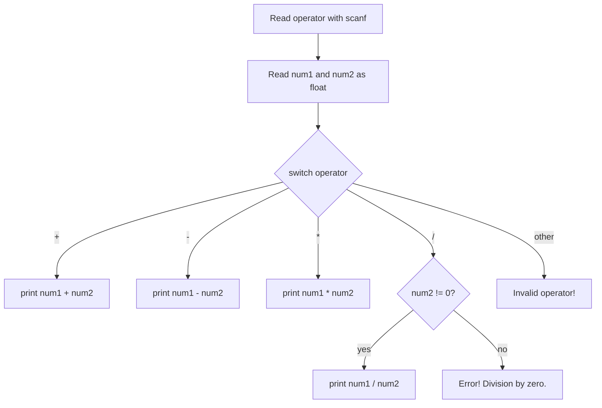

# Basic Calculator in C: Low-Level Design

For the big picture see the [High-Level Design](hld.md).

## 1. Program flow

## 2. Data

| Variable | Type | Purpose |
|---|---|---|
| `operator` | `char` | One of `+ - * /` (read with `" %c"` to skip leftover whitespace) |
| `num1`, `num2` | `float` | Operands |

Results are printed as `%.2f`, e.g. `3.00 / 2.00 = 1.50`.
